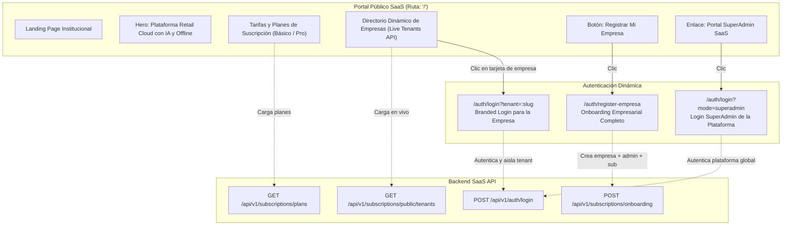

# PLAN 20: Portal SaaS Landing, Directorio Dinámico de Empresas y Eliminación de Demo Hardcodeada

## 1. Justificación y Fundamentación Arquitectónica

### 1.1 Contexto de la Materia SI2 (Sistemas de Información 2)
- **Requisito 1 (Solución Universal):** El sistema debe ser comercializable y aplicable a cualquier empresa de retail/moda sin recompilar ni alterar código.
- **Requisito 8 (Modelo SaaS en la Nube):** El modelo de negocio se basa en suscripciones pagadas en la nube. Debe existir una cara pública donde los clientes conozcan los planes, precios y características, y las organizaciones suscritas tengan su portal de acceso aislado.

### 1.2 Benchmark de la Industria (¿Cómo lo hacen los líderes SaaS?)
1. **Slack (`slack.com/signin/find`):**
   - Una landing institucional explica el producto.
   - Existe una sección para "Buscar tu espacio de trabajo (Workspace)" o ingresar mediante el slug de la organización (`empresa.slack.com`).
   - Los datos y usuarios de cada workspace están 100% aislados.
2. **Shopify (`shopify.com`):**
   - Página principal pública con catálogo de características y precios de planes.
   - Selector o buscador de tiendas para el comerciante.
   - Flujo de Onboarding de autoservicio ("Comienza tu prueba gratis de 14 días").
3. **WorkOS & Microsoft 365 (Enterprise Multi-Tenant):**
   - Detección de Tenant por dominio de correo corporativo (`@urbanstyle.com` -> redirige a la instancia de UrbanStyle).
   - Brand Morphing reactivo (la pantalla de autenticación se viste con los colores y logo corporativos de la empresa solicitada).

---

## 2. Problema Actual Identificado

1. **Botones de Demo Hardcodeados en el Login:**
   - La pantalla `login.component.html` tiene 3 botones estáticos con etiquetas fijas (*"UrbanStyle PRO"*, *"Moda Express BÁSICO"*, *"SuperAdmin GLOBAL"* y *"Empresa Demo para la Defensa"*).
   - Si un usuario crea una 3ra o 4ta empresa (ej. *"Boutique París"*, *"Zara Tarija"*), **no aparece en el login**.
   - Da una apariencia de prototipo académico en lugar de un SaaS de producción.
2. **Ausencia de Landing Page Pública:**
   - Al entrar a la URL raíz (`http://localhost:4200/`), el sistema redirige inmediatamente a `/auth/login`.
   - El visitante o cliente potencial no puede ver qué servicios ofrece el SaaS, los planes disponibles ni los precios en bolivianos antes de ingresar.
3. **Flujo de Onboarding Incompleto:**
   - El registro en `/auth/register` actualmente solo registra un usuario individual, no un Tenant empresarial con su plan de suscripción asociado.

---

## 3. Arquitectura de la Solución Propuesta

---

## 4. Componentes a Implementar

### 4.1 Backend (FastAPI)
1. **Endpoint Público de Onboarding de Empresas (`POST /api/v1/subscriptions/onboarding`):**
   - Permite a una nueva empresa registrarse desde la web pública:
     - Datos de la empresa: Nombre comercial, Razón Social, NIT/RUT, Slug único, teléfono, ciudad.
     - Plan seleccionado: `BASICO` o `PROFESIONAL`.
     - Datos del Administrador inicial: Nombre completo, correo corporativo, contraseña segura.
   - Creación en transacción atómica:
     - Crea el `Tenant` con colores por defecto.
     - Crea la `Subscription` activa por 1 año / periodo de prueba.
     - Crea el `Role` de administración para la empresa y el usuario `User` inicial.
     - Retorna las credenciales y el slug para redirección inmediata.
2. **Mejora en `GET /api/v1/subscriptions/public/tenants`:**
   - Retornar información enriquecida para el directorio:
     - `nombre`, `slug`, `logo_url`, `color_primario`, `color_secundario`, `eslogan`, `plan_nombre`, `ciudad`.

### 4.2 Frontend Web (Angular 19 Standalone)
1. **Nuevo Componente `SaaSLandingComponent` (Ruta `/`):**
   - **Hero Section:** Propuesta de valor de la plataforma SaaS (Comercio Unificado, Resiliencia Offline, Asistente IA, Multi-sucursal).
   - **Directorio de Empresas (Live Tenant Directory):**
     - Consume `SubscriptionService.getPublicTenants()`.
     - Barra de búsqueda reactiva por nombre de empresa o ciudad.
     - Tarjetas modernas con el logo, nombre, eslogan, badge del plan y botón *"Ingresar a esta Empresa"*.
     - **Crecimiento dinámico:** Al crearse una nueva empresa, se lista aquí al instante sin tocar código.
   - **Sección de Precios y Planes:**
     - Consume `SubscriptionService.getPlans()`.
     - Tarjetas comparativas de planes (Básico: 1 sucursal, POS; Profesional: Multi-sucursal, IA, Offline).
   - **Navbar y Footer:** Enlaces a *"Acceso SuperAdmin"* y *"Registrar Empresa"*.
2. **Refactorización Limpia de `LoginComponent` (`/auth/login`):**
   - **Eliminar por completo los 3 botones estáticos de demo.**
   - Soporte para parámetro URL `?tenant=slug` o `?mode=superadmin`.
   - Si viene con `tenant`:
     - Carga el tema y logo de la empresa seleccionada.
     - Muestra un botón sutil *"← Cambiar de Organización"* que vuelve al directorio.
   - Si no viene con `tenant`:
     - Permite ingresar el correo corporativo (el Brand Morphing detecta la empresa en tiempo real mientras escribe el usuario).
     - Incluye un selector desplegable con buscador de las empresas registradas.
   - Muestra mensajes de error reales del backend (credenciales incorrectas, usuario inactivo o empresa suspendida).
3. **Nuevo Componente de Onboarding Empresarial (`/auth/registro-empresa`):**
   - Formulario profesional de 3 pasos:
     1. Información del negocio (Nombre comercial, NIT, Ciudad).
     2. Selección de Plan (Básico o Profesional).
     3. Creación de cuenta de Administrador (Nombre, Correo, Contraseña).

---

## 5. Matriz de Validación y Casos de Prueba

| ID | Escenario de Prueba | Resultado Esperado |
|---|---|---|
| **TC-20.1** | Visitar `http://localhost:4200/` sin sesión iniciada | Carga la Landing Page pública con el Hero, Planes y el Directorio de empresas activas en BD. |
| **TC-20.2** | Clic en la tarjeta de `UrbanStyle` en el directorio | Redirige a `/auth/login?tenant=urbanstyle`. La pantalla adopta la identidad visual morada y el logo de UrbanStyle. |
| **TC-20.3** | Clic en la tarjeta de `Moda Express` | Redirige a `/auth/login?tenant=modaexpress`. La pantalla adopta la identidad visual ámbar y el logo de Moda Express. |
| **TC-20.4** | Clic en "Acceso SuperAdmin de Plataforma" | Redirige a `/auth/login?mode=superadmin`. Estilo corporativo SaaS neutral listo para gestionar tenants. |
| **TC-20.5** | Crear una nueva empresa vía Onboarding o SuperAdmin | La nueva empresa aparece inmediatamente en la Landing Page con su tarjeta interactiva. |
| **TC-20.6** | Validación de Credenciales | Si el usuario introduce contraseña incorrecta, se despliega alerta clara sin romper el estado del tenant. |
| **TC-20.7** | Compilación y Tipado | `npm run build` y validación de endpoints FastAPI con código de salida 0. |

---

## 6. Análisis Integral: ¿Qué más podemos optimizar en el proyecto?

Para asegurar la máxima nota y solidez en la defensa:

1. **Gestión de Permisos Granulares por Componente (Punto 2 SI2):**
   - La arquitectura actual de roles y permisos ya cuenta con tablas y guards.
   - Mejora sugerida: Asegurar que una directiva estructural en Angular (`*hasPermission="'ventas.crear'"`) oculte botones específicos dentro de los formularios para que el evaluador vea cómo un cajero no ve el botón de "Eliminar" o "Aplicar Descuento Especial".
2. **Asistencia en Línea y Facilidad de Uso (Punto 4 SI2):**
   - Implementar un botón flotante de ayuda contextual / tour interactivo guiado o consulta rápida al Chatbot IA sobre cómo usar cada pantalla del sistema.
3. **Sincronización Offline Bidireccional en Móvil (Punto 7 SI2):**
   - Asegurar que las ventas o inventario registrados en modo offline en la app móvil muestren una cola visual de elementos pendientes por subir y badge verde de "Sincronizado" al reconectar.

