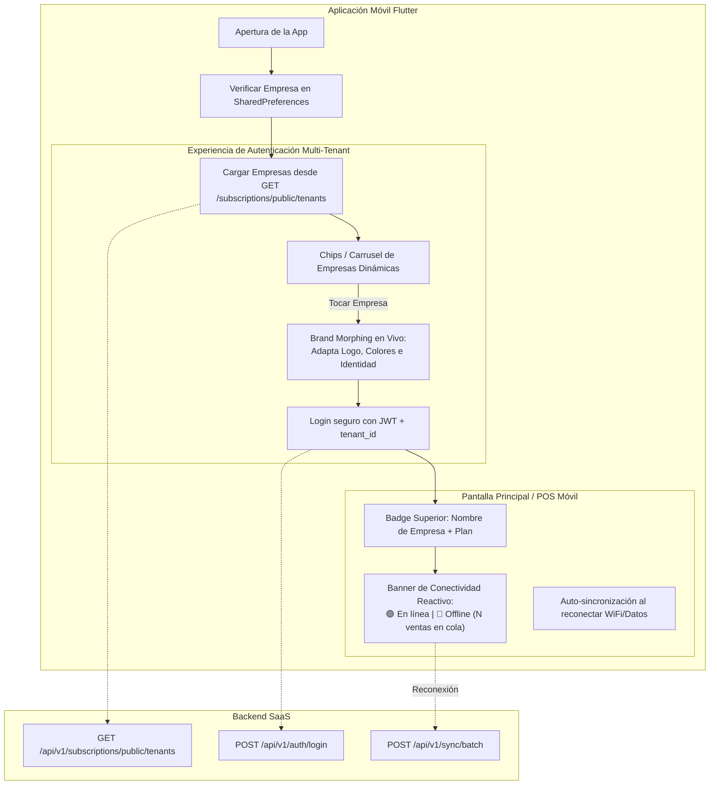

# PLAN 21: Selector Dinámico de Empresas (Tenant Brand Morphing) y Resiliencia Offline Visual en Flutter Mobile

## 1. Justificación y Fundamentación Arquitectónica

### 1.1 Contexto de la Materia SI2 (Sistemas de Información 2)
- **Requisito 7 (Web/Móvil):** Identificar funcionalidades convenientes para Web (administración, reportes, configuración global SaaS) y funcionalidades para Móvil (punto de venta ágil, catálogo, fidelización de clientes y operación en contingencia offline).
- **Requisito 8 (Modelo SaaS en la Nube):** La app móvil debe adaptarse dinámicamente a cualquiera de las empresas inquilinas (*tenants*) alojadas en la nube sin necesidad de compilar un APK separado para cada cliente.

### 1.2 Benchmark de la Industria Móvil (Slack, Shopify POS, Teams)
1. **Slack Mobile:** Permite cambiar o alternar entre espacios de trabajo (Workspaces). Cada uno mantiene su logo, paleta y caché local de mensajes aislada.
2. **Shopify POS:** Identifica la tienda asignada al vendedor, sincroniza el catálogo local en SQLite y muestra un chip visible cuando la tienda entra en modo de contingencia sin conexión (Offline).

---

## 2. Diagnóstico del Estado Actual en Mobile

1. **Login Móvil Rígido:**
   - La pantalla `login_screen.dart` tiene el logo estático de FICTT STORE hardcodeado.
   - No hay forma visual para que el usuario o el docente sepa a qué empresa se está conectando antes de ingresar sus credenciales.
2. **Desconexión con la API de Tenants:**
   - La app móvil no aprovecha el endpoint `GET /api/v1/subscriptions/public/tenants`, el cual ya provee nombres, slugs, colores primarios/secundarios y logos.
3. **Indicador Offline Subutilizado:**
   - Si bien `OfflineSyncService` y `ConnectivityService` existen en el código y guardan ventas en SQLite, el usuario final no tiene un **banner visual persistente y elegante en la pantalla principal** que le informe si está en línea (🟢) o si está operando fuera de línea con transacciones pendientes en cola (🔴).

---

## 3. Arquitectura de la Solución Propuesta

---

## 4. Componentes Técnicos a Implementar

### 4.1 Modelo de Datos y Configuración
1. **Endpoint en `ApiConfig` (`mobile/lib/config/api_config.dart`):**
   - `static String get publicTenantsUrl => '$apiUrl/subscriptions/public/tenants';`
2. **Modelo `TenantModel` (`mobile/lib/models/tenant_model.dart`):**
   - Propiedades: `id`, `nombre`, `slug`, `logoUrl`, `colorPrimario`, `colorSecundario`, `eslogan`, `planCodigo`.
   - Parsing JSON resiliente y fallback de colores predeterminados (`#4f46e5`).

### 4.2 Servicio de Branding Dinámico (`TenantThemeService` o mejora de `ThemeService`)
- Permite almacenar en memoria y en `SharedPreferences` la empresa seleccionada.
- Provee un método `applyTenant(TenantModel tenant)` que notifica a la UI para repintar los botones, bordes y encabezados con el color corporativo de la tienda seleccionada.

### 4.3 Refactorización de `LoginScreen` (`mobile/lib/screens/auth/login_screen.dart`)
- **Carrusel horizontal de Chips de Empresas:**
  - Ubicado entre el logo y los campos de texto.
  - Cada chip muestra: punto indicador de color, nombre de la empresa y badge de plan (`PRO` / `BÁSICO`).
  - Al presionar un chip:
    - Se actualiza el color primario del botón y del acento visual.
    - Se actualiza el título corporativo (ej: *"Bienvenido a UrbanStyle"*).
    - Se rellena automáticamente una sugerencia de correo corporativo para agilidad en la defensa.
- **Soporte Offline en Login:** Si no hay internet, recupera del almacenamiento local la última empresa utilizada.

### 4.4 Banner de Conectividad y Resiliencia (`OfflineConnectivityBanner`)
- Widget reactivo integrado en el Home/POS móvil:
  - **Estado Online (Verde):** `"🟢 En línea — Conectado a la nube"`. Se oculta discretamente tras 3 segundos.
  - **Estado Offline (Ámbar/Rojo):** `"🔴 Modo Contingencia Offline — Guardando ventas en SQLite local (N operaciones pendientes)"`.
  - Botón interactivo `"Sincronizar ahora"` que fuerza el vaciado de la cola local hacia `POST /api/v1/sync/batch` una vez detectada la red.

---

## 5. Matriz de Validación y Casos de Prueba

| ID | Caso de Prueba | Resultado Esperado |
|---|---|---|
| **TC-21.1** | Abrir la app móvil con internet | Consulta la API pública y muestra los chips de `UrbanStyle`, `Moda Express` y cualquier empresa creada en la web. |
| **TC-21.2** | Tocar el chip de `UrbanStyle` | La pantalla adapta su botón a tono índigo (`#4f46e5`), muestra su subtítulo y slogan corporativo. |
| **TC-21.3** | Tocar el chip de `Moda Express` | La pantalla conmuta su botón a tono ámbar (`#d97706`) de manera instantánea. |
| **TC-21.4** | Iniciar sesión exitosamente | Ingresa al Home con el token scoped de la empresa seleccionada. |
| **TC-21.5** | Desconectar WiFi / Activar Modo Avión | Aparece de inmediato el banner flotante alertando que se encuentra en modo offline y que las operaciones se guardarán localmente en SQLite. |
| **TC-21.6** | Realizar una venta sin internet y reconectar | La venta se registra con folio offline local. Al reactivar la red, el banner muestra el auto-sync y la venta sube al PostgreSQL del backend. |

