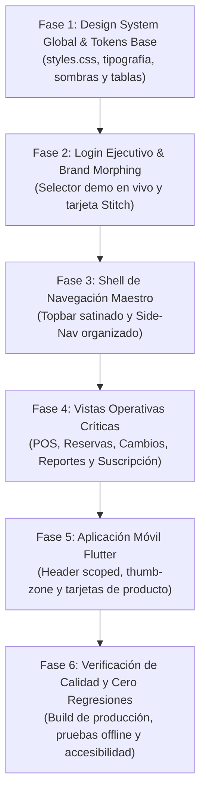

# 🎨 PLAN MAESTRO DE REDISEÑO PROFESIONAL "STITCH & SAAS MULTITENANT"
## Plataforma Omnicanal FashionStore (Web Angular 19 PWA & Mobile Flutter)

---

## 1. Visión y Principios del Rediseño

Este plan transforma la interfaz visual y la experiencia de usuario (UX) de **FashionStore** para alcanzar el estándar visual de plataformas líderes mundiales de SaaS y retail omnicanal (**Google Stitch**, **Shopify POS**, **Square for Retail**, **Stripe Billing** y **Linear**).

### Principios Rectores:
1. **Lienzo Neutro de Alta Gama (Neutral Canvas):**  
   Reemplazar fondos apagados o cremas por un lienzo ultra limpio (`#F8FAFC` / `#FFFFFF`), con bordes nítidos (`#E2E8F0`) y sombras difusas multicapa. Esto garantiza que cualquier color corporativo que elija una empresa se vea profesional y legible.
2. **Branding Quirúrgico del Tenant (White-Labeling Balanceado):**  
   Los colores de marca de la empresa (`color_primario` y `color_secundario`) se aplican con precisión quirúrgica en componentes interactivos clave: botones principales (CTAs), focus rings de inputs, estados activos del menú lateral y badges destacados.
3. **Funcionalidad Superior y Cero Regresiones (100% Preservado):**  
   El rediseño es estrictamente de capa de presentación (CSS, diseño atómico, maquetación flex/grid e iconografía). No se altera ninguna directiva de enlace (`ngModel`, `formControlName`, `Signals`), contratos de API, bases de datos, IndexedDB ni el motor de sincronización offline.
4. **Optimización de Rendimiento:**  
   Animaciones por GPU (`transform`, `opacity`), CSS modular sin sobrecoste de runtime y tiempos de carga instantáneos en la PWA y en la app móvil.



---

## FASE 1: Design System Global & Tokens Base (`styles.css`)

**Objetivo:** Modernizar la base visual completa del proyecto para que todos los componentes existentes hereden de inmediato un acabado profesional, nítido y consistente.

### Tareas Clave:
* **1.1. Renovación de Design Tokens en `:root`:**
  * Fondo dominante (`--bg-main`): Sustituir `#EFECE6` por `#F8FAFC` (porcelana satinado).
  * Fondo de superficies (`--bg-surface`): `#F1F5F9` (slate 100 nítido).
  * Fondo de tarjetas (`--bg-card`): `#FFFFFF` puro con borde sutil `1px solid #E2E8F0`.
  * Tipografía: Definir escala con *Inter* / *Plus Jakarta Sans* y títulos en *Outfit* con tracking fino (`letter-spacing: -0.02em`).
* **1.2. Sistema de Sombras Elevadas ("Layered Soft Shadows"):**
  * `--shadow-sm: 0 1px 2px 0 rgba(15, 23, 42, 0.05);`
  * `--shadow-md: 0 4px 6px -1px rgba(15, 23, 42, 0.07), 0 2px 4px -2px rgba(15, 23, 42, 0.05);`
  * `--shadow-lg: 0 10px 15px -3px rgba(15, 23, 42, 0.08), 0 4px 6px -4px rgba(15, 23, 42, 0.04);`
* **1.3. Estandarización de Controles de Formulario:**
  * Inputs con altura uniforme de 44px, radio de 8px-10px, padding de 12px 14px.
  * Focus ring suave con color primario dinámico: `box-shadow: 0 0 0 3px rgba(var(--primary-rgb), 0.15)`.
* **1.4. Tablas de Datos Estilo SaaS Ejecutivo:**
  * Cabeceras en mayúsculas sutiles (`font-size: 0.75rem`, `color: #64748B`, `background: #F8FAFC`).
  * Filas con hover suave interactivo (`transition: background 0.15s ease`).
  * Pastillas de estado redondeadas (*status chips*) con micro-dot de pulso y fondos traslúcidos.
* **1.5. Corrección de Caracteres Especiales y UTF-8:**
  * Corregir símbolos de moneda (`Bs.`) y tildes corruptas en plantillas globales.

---

## FASE 2: Pantalla de Login Ejecutiva con "Brand Morphing"

**Objetivo:** Dar una primera impresión impactante al docente o evaluador, con capacidad de alternar entre empresas de prueba y ver la marca cobrar vida en tiempo real.

```
┌─────────────────────────────────────────────────────────────┐
│                      FASHIONSTORE SAAS                      │
│                                                             │
│  [🏢 UrbanStyle Pro]  [🏢 Moda Express]  [🛡️ SuperAdmin]   │  <- Pastillas Demo
│                                                             │
│  ┌───────────────────────────────────────────────────────┐  │
│  │                     [ LOGO TENANT ]                   │  │
│  │                   UrbanStyle Bolivia                  │  │
│  │             Moda urbana y diseño exclusivo            │  │
│  │                                                       │  │
│  │  Correo Corporativo                                   │  │
│  │  [ ✉️ admin@urbanstyle.com                          ]  │  │
│  │                                                       │  │
│  │  Contraseña                                           │  │
│  │  [ 🔒 ••••••••••••••••                              ]  │  │
│  │                                                       │  │
│  │  [       Iniciar Sesión en UrbanStyle →             ]  │  │  <- Color de Marca
│  └───────────────────────────────────────────────────────┘  │
└─────────────────────────────────────────────────────────────┘
```

### Tareas Clave:
* **2.1. Tarjeta Flotante Minimalista:**
  * Contenedor centrado con fondo blanco puro, borde perimetral suave y sombra de alta elevación (`shadow-lg`).
* **2.2. Barra Superior de Acceso Demo para la Defensa:**
  * Pastillas tipo pill para alternar en 1 clic entre:
    * **UrbanStyle (Plan Pro - Santa Cruz):** Colores índigo/violeta (`#4F46E5`).
    * **Moda Express (Plan Básico - Tarija):** Colores ámbar cálido (`#D97706`).
    * **SuperAdmin Global:** Colores slate corporativo (`#0284C7`).
* **2.3. Micro-interacción de Morphing:**
  * Al hacer clic en una empresa demo o al ingresar su correo, la tarjeta anima suavemente el logotipo, el nombre, el eslogan y el botón de inicio de sesión con los colores exactos de la empresa seleccionada.

---

## FASE 3: Shell de Navegación Maestro (Topbar + Side-Nav)

**Objetivo:** Proporcionar un marco de trabajo corporativo donde el usuario siempre tenga claro su contexto operativo (empresa, sucursal, estado de red y usuario).

### Tareas Clave:
* **3.1. Topbar Satén con Glassmorphism:**
  * Fondo traslúcido satinado con filtro de desenfoque (`backdrop-filter: blur(14px); background: rgba(255, 255, 255, 0.88)`).
  * **Brand Chip:** Logo corporativo + Nombre de la empresa + Pastilla del plan (`PROFESIONAL` / `BÁSICO`).
  * **Selector de Sucursal Rápido:** Indicador elegante de la sucursal actual (ej. `Sucursal Equipetrol`).
  * **Indicador de Conectividad / Sincronización:**
    * Pastilla compacta con micro-dot de pulso verde (`En Línea`) o ámbar (`Offline (3 pendientes)`).
    * Al hacer clic, abre el modal de sincronización con IndexedDB.
  * **Botón de Reportes IA por Voz:** Acceso directo con ícono de micrófono estilizado.
  * **User Profile:** Avatar redondo con iniciales o ícono, nombre del usuario y rol activo.
* **3.2. Side-Nav (Offcanvas de la Capa Específica):**
  * Agrupación organizada de los 5 paquetes funcionales del sistema con encabezados colapsables y badges numéricos de módulos.
  * Buscador reactivo de módulos con filtrado en tiempo real.
  * Estados activos destacados con el color primario del tenant y pequeña barra de acento lateral.

---

## FASE 4: Vistas Operativas Críticas (POS, Reservas, Cambios y Suscripción)

**Objetivo:** Transformar las pantallas de uso diario en interfaces de alta productividad inspiradas en Shopify POS y Stripe.

### Tareas Clave:
* **4.1. Punto de Venta (POS):**
  * Distribución a 2 columnas con proporción 65/35 (Catálogo interactivo / Ticket de venta fijado a la derecha).
  * Filtro de categorías mediante pastillas horizontales deslizables con badges de conteo.
  * Tarjetas de producto visuales con precio destacado en grande (`180.00 Bs.`) e indicador de stock en tiempo real.
  * Ticket de venta con lista de items, selector de cantidad `+` / `-`, cálculo automático de subtotal, impuestos y botón de cobro prominente.
* **4.2. Lista de Reservas:**
  * Segmentación por pestañas (*Pendientes*, *Preparadas*, *Historial Completo*).
  * Filtro rápido por sucursal y buscador por código/cliente.
  * Botones de acción contextuales según rol (`Preparar`, `Entregar`, `Cancelar`).
* **4.3. Gestión de Cambios de Prendas (CU-17):**
  * Buscador rápido por número de recibo de venta con verificación automática de la ventana de 30 días.
  * Comparador visual de prenda devuelta vs prenda nueva con cálculo dinámico de la diferencia (`A favor del cliente` o `Saldo a pagar`).
* **4.4. Módulo de Suscripción & Gobernanza SaaS:**
  * **Pestaña 1 (Mi Suscripción):** Tarjetas de métricas de uso de cupos (sucursales activas vs permitidas).
  * **Pestaña 2 (Identidad & Branding):** Editor de colores con vista previa interactiva en tiempo real (color picker + inputs hexadecimales).
  * **Pestaña 3 (SuperAdmin):** Tabla de gobernanza de todas las empresas con switches de activación/desactivación y métricas de MRR.

---

## FASE 5: Aplicación Móvil (Flutter) - Experiencia Retail Contemporánea

**Objetivo:** Llevar las mismas pautas de diseño limpio y funcional a la aplicación móvil Flutter para Android/iOS.

### Tareas Clave:
* **5.1. Scoped Top App Bar:**
  * Header con logo del tenant, selector de sucursal con bottom-sheet y estado de sincronización SQLite.
* **5.2. Tarjetas de Catálogo Mobile:**
  * Relación de aspecto optimizada para pantallas táctiles, selector de talla y color en carrusel horizontal e indicador de stock inmediato.
* **5.3. Carrito y Checkout "Thumb-Zone":**
  * Botón flotante de compra anclado en la parte inferior para fácil pulsación con una sola mano.
* **5.4. Pantalla de Sincronización Offline:**
  * Lista de transacciones guardadas localmente en SQLite con estados (`PENDIENTE`, `SINCRONIZADO`, `CONFLICTO`) y botón de reintento masivo.

---

## FASE 6: Verificación de Calidad, Rendimiento y Cero Regresiones

**Objetivo:** Garantizar que todo funcione con máxima rapidez y estabilidad antes de cualquier entrega o defensa.

### Checklist de Validación:
1. **Compilación Limpia:**
   * Backend Python: `compileall` con código de salida 0.
   * Frontend Angular: `npm run build` en modo producción sin errores TypeScript.
2. **Pruebas de Funcionalidad Operativa:**
   * Venta en POS online y offline (almacenamiento en IndexedDB).
   * Sincronización de transacciones pendientes al recuperar red.
   * Cancelación y preparación de reservas por administradores y encargados.
   * Generación de reportes generativos por voz con IA y exportación a Excel.
   * Restricción estricta de cupos por plan (Plan Básico bloquea tercera sucursal y reportes IA).
3. **Pruebas de Aislamiento Multi-Tenant (RNF02):**
   * Verificar que iniciar sesión con *Moda Express* no muestre productos ni ventas de *UrbanStyle*.
4. **Auditoría de Rendimiento y Accesibilidad:**
   * Contraste de texto WCAG AA sobre fondos blancos y de color.

---

## Cronograma de Ejecución Propuesto

| Fase | Alcance | Prioridad | Duración Estimada |
| :--- | :--- | :---: | :---: |
| **Fase 1** | Design System Global en `styles.css` (Lienzo neutro, sombras, inputs y tablas) | 🔴 Alta | Inmediata |
| **Fase 2** | Rediseño de Login con Brand Morphing y Selector de Empresas Demo | 🔴 Alta | Inmediata |
| **Fase 3** | Rediseño del Topbar Satinado y Side-Nav de Paquetes | 🟡 Media | Siguiente paso |
| **Fase 4** | Pulido de POS, Reservas, Cambios y Dashboard | 🟡 Media | Continuación |
| **Fase 5** | Adaptación de componentes visuales en Flutter | 🟢 Normal | Posterior |
| **Fase 6** | Build final, pruebas de humo y confirmación | 🔴 Alta | Cierre |
